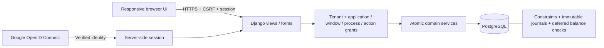

# Architecture and security

## Recommended stack

Use a Django 5.2 LTS monolith on Python 3.13, PostgreSQL 17, Gunicorn behind an HTTPS reverse proxy, and WhiteNoise for versioned static assets. Django templates, CSS Grid and small progressive enhancements provide the UI. A separate JavaScript framework is unnecessary for this first release; avoiding two deployments reduces operational complexity. Add an API or SPA when an integration or interaction requires one, keeping financial logic in `erp/services.py`.

Django supplies migrations, database transactions, form validation, CSRF protection, session rotation and cookie handling. PostgreSQL supplies exact decimals, uniqueness, row locking and deferred integrity triggers. One small application host and a backed-up database are the initial infrastructure footprint; no specific cloud price is assumed. A managed database reduces maintenance at additional cost; self-hosting needs operator-owned monitoring and restore drills.

References: [Django 5.2 LTS release](https://docs.djangoproject.com/en/5.2/releases/5.2/), [Django deployment checklist](https://docs.djangoproject.com/en/5.2/howto/deployment/checklist/), [Google OpenID Connect](https://developers.google.com/identity/openid-connect/openid-connect).

## Identity versus authorization

1. The operator bootstraps a company and its first administrator's email. Administrators provision additional emails, branches and role assignments. No public signup or automatic email-domain company membership exists.
2. `/auth/google/` stores cryptographically random state and nonce in the server session and redirects to Google with `openid email profile`.
3. The callback verifies state and age, exchanges the authorization code server-side, and verifies Google's signed ID token with `google-auth`: audience, issuer, signature and expiry. It also checks nonce and verified email.
4. The first login binds Google's stable `sub` to exactly one invited account. Subsequent logins resolve that stable subject. New/uninvited accounts and inactive users/memberships are denied.
5. Django rotates the session at login. Only an HttpOnly SameSite cookie is sent to the browser; no Google token or client secret is stored in local storage.
6. Each request resolves an active tenant membership from the signed-in user. There is no request-header override or unvalidated tenant query parameter. A company switch endpoint validates membership before updating the session.
7. Every screen, process and export checks database grants again. Revocation applies on the next request. Django superuser status does not bypass the application permission matrix.

Google authentication cannot be verified end-to-end without your OAuth client configuration and a real invited account. Tests exercise callback state, verified identity binding and uninvited-user rejection with a mocked provider; they do not claim a real Google login occurred.

## Four-tier RBAC

`Permission(application, window, process, action)` is a unique catalog entry; `Grant(role, permission, scope, can_export)` makes the role matrix. Users can hold multiple roles within each membership and memberships in multiple companies. Roles and all business rows belong to one tenant.

| Example path | Action | Meaning |
|---|---|---|
| `jobs.list.manage` | C / R / U | Create, inspect or edit jobs |
| `costs.detail.match` | C | Record a supplier bill |
| `costs.detail.variance` | U | Approve a flagged bill variance |
| `costs.detail.unlock` | U | Supervisor unlock with reason |
| `customers.ledger.view` | R / X | Read a ledger or separately export it |
| `settings.roles.manage` | C / R / U / D | Company security administration catalog |

Scopes combine as a union of positive grants: **none**, **self** (`created_by`), **branch** (`branch`), or **global** (all records within that company). A role with `none` does not subtract permission granted by another role. Export needs its own X grant and `can_export=true`; a view grant alone is insufficient. Global never means cross-company.

The server scopes lists, record lookups, form foreign-key choices, financial mutations and exports. Dashboard data is intersected with both overview scope and the relevant module scope. Financial actions check their own process, not only screen access. UI buttons use grant checks for usability; the server remains authoritative.

Role/member administration is security-administrator functionality: it can delegate broad company access, so do not assign it to ordinary operational roles. The initial D catalog entry is reserved for future role deletion; financial and master deletion endpoints are deliberately not exposed. Member administration currently manages company memberships with a company-level privilege, rather than per-record self scopes; assign its grants as global. Company-local role and user changes are audited.

## Tenant isolation

Application queries always filter tenant plus scope. Form validation rejects foreign tenant relations. PostgreSQL triggers additionally reject cross-company business foreign keys and cross-company membership/role assignments, and prevent moving an existing row to another tenant.

This is **application-scoped tenancy with relational database guards**, not PostgreSQL row-level security. A trusted database operator can read rows from all tenants. For higher isolation, add forced RLS under a non-owner application role with transaction-local tenant context, or a separate database per company. PostgreSQL's [row-security documentation](https://www.postgresql.org/docs/17/ddl-rowsecurity.html) explains ownership and bypass semantics. Do not enable incomplete policies without ensuring login, membership selection, migration and background-job access continue to work.

## Financial boundaries

All public mutations authorize before accessing or changing money, acquire the cost-sheet or invoice row lock, validate the state, post within one transaction, and record the actor. Database uniqueness prevents duplicated source postings, invoice charge use, customer/job numbers and payment references.

| Event | Debit | Credit |
|---|---|---|
| Booking | Direct costs | Accrued costs |
| Supplier bill, above estimate | Accrued costs + variance expense | Payables |
| Supplier bill, below estimate | Accrued costs | Payables + reduction in expense |
| Customer invoice issue | Receivables | Freight revenue + VAT payable |
| Receipt at carrying rate | Bank | Receivables |

Amounts round half-up to two decimal places. FX is explicit base-currency units per transaction-currency unit. Base currency requires FX=1. Variances compare quantity, unit price and base value independently, so offsetting differences cannot silently pass. Actual margin uses matched bills; unmatched estimates remain accrued in the displayed financial position.

PostgreSQL enforces balanced journals at commit, at least two lines, positive debit or credit per line, immutable posted entries/lines, and no additions to previously committed postings. Audit events are append-only there. SQLite does not supply those trigger/locking guarantees. Future corrections must use reversal workflows; no posted editing UI is supplied.

## Growth path

Add fiscal periods, credit notes/reversals, AP settlement and FX remeasurement before accounting rollout. Then add document storage with signed access, queues only when asynchronous tasks require them, integrations through audited services, and observability. Keep operational estimates distinct from actual documents and preserve currency/tax snapshots across future changes.
