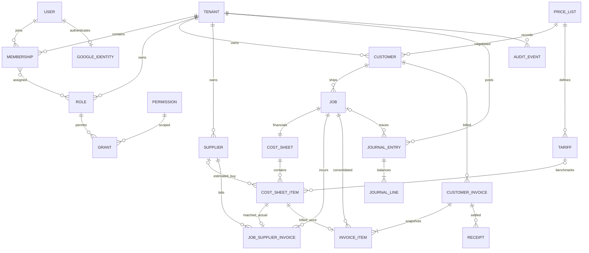

# Data model / ERD

The authoritative schema is `erp/models.py` and migrations `0001`–`0003`. Django's `auth_user` stores users; `erp_googleidentity` binds the immutable Google subject. All business identifiers use UUIDs; auth users, membership and catalog IDs use Django integer keys.

## Table mapping

| Django model / table | Important columns / constraints |
|---|---|
| `Tenant` / `erp_tenant` | Legal identity, base currency, variance tolerance |
| `User` / `auth_user` | Email, active flag; initial provisioning rejects ambiguous email matches |
| `GoogleIdentity` | Unique provider subject; one identity per user |
| `Membership` + `erp_membership_roles` | Unique (tenant, user), active, branch, multiple roles |
| `Role` | Unique (tenant, name), description |
| `Permission` | Unique (application, window, process, C/R/U/D/X) |
| `Grant` | Unique (role, permission), scope, separate export switch |
| `Customer` | Unique tenant code; name, TRN, contacts, city, billing/shipping, currency, credit, terms, price list |
| `Supplier` | Unique tenant code; service type, TRN, contact, bank details, currency and credit terms |
| `PriceList` / `Tariff` | Currency, validity, default flag; service, unit, route, buy/sell benchmark |
| `Job` | Unique tenant number; customer, references, mode/status, POL/POD, vessel, cargo, dates, proof-of-delivery reference |
| `CostSheet` | One per job; approved, locked timestamp/actor |
| `CostSheetItem` | BUY/SELL, supplier, tariff, quantity, unit rate, currency, FX, tax/exemption, accrued flag |
| `JobSupplierInvoice` | One bill line per buy estimate; job, supplier invoice reference/dates, actual quantity/rate/FX, variance, approval actor/reason, matching status |
| `CustomerInvoice` | Unique tenant invoice number; customer, frozen legal/billing identity, dates, currency/FX, subtotal/tax/total, paid amount, state |
| `InvoiceItem` | Unique cost item; invoice, job, frozen description, quantity/rate/tax amounts |
| `Receipt` | Unique tenant reference; invoice, positive amount, receipt date |
| `JournalEntry` | Unique tenant source key; description, date, job, posting transaction |
| `JournalLine` | Account, debit/credit, exactly one positive side; deferred balanced-entry check on PostgreSQL |
| `AuditEvent` | Actor, time, branch, action, object type/id, reason/detail |

Tenant-owned rows inherit `tenant`, `branch`, `created_by` and `created_at`. Foreign keys use `PROTECT` for business history. Invoice items reference jobs, making one invoice across several jobs possible without duplicating sell charges. Amounts are `numeric(18,2)`; quantities have three decimals and FX rates eight decimals. Invoice payment bounds are database checked. Overdue is calculated from due date, current outstanding state and balance rather than stored by a daily scheduler.

The supplier invoice model intentionally represents a **bill line**, linked one-to-one with an estimate. A supplier invoice number can appear against multiple estimate lines. Partial billing, supplier tax headers and invoice-level duplicate header detection need a normalized header/line extension before AP rollout.

## Executable SQL

Configure PostgreSQL environment variables, then use `python manage.py sqlmigrate erp 0001` to inspect the table/index/constraint DDL. Migrations `0002` and `0003` use vendor-specific `RunPython` installers to execute trigger DDL; their functions are visible directly in those files. Apply the complete schema with `python manage.py migrate`. Never apply SQL copied from an ERD instead of tracked migrations.
